# Origami modules for Bubble Card

Eleven [Bubble Card](https://github.com/Clooos/Bubble-Card) modules that give its cards the Origami look: the same frame, type, colours and controls as the rest of the dashboard. They read the theme's tokens, so they need the [Origami theme](../README.md#setup).

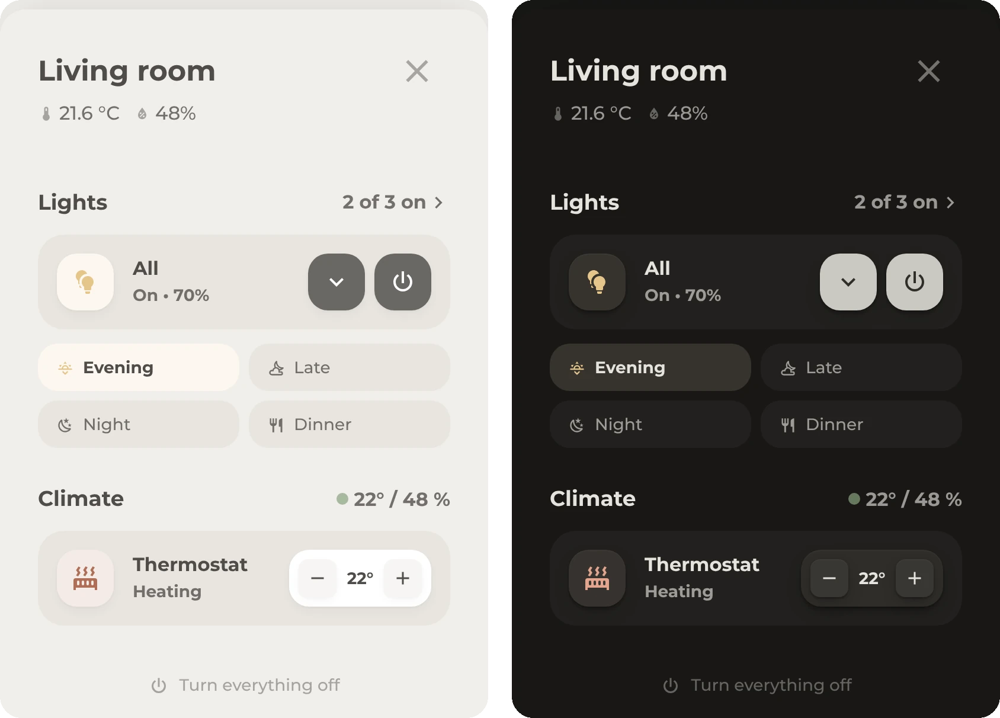

## Install

1. Install [Bubble Card](https://github.com/Clooos/Bubble-Card) and [Bubble Card Tools](https://github.com/Clooos/Bubble-Card-Tools) from HACS. Bubble Card Tools is an integration, add it under **Settings > Devices & services** after a restart. It stores modules as files.
2. Copy the files from [`modules`](modules) to `/config/bubble_card/modules/`.
3. Reload the dashboard. The modules show up in the Bubble Card editor under **Modules**.

<details>
<summary>Without copying files</summary>

<br>

Open any Bubble Card in the editor, go to **Modules > My Modules > Import from YAML** and paste the content of one module file. Repeat for each module. Bubble Card Tools is needed for this too.

</details>

## How they fit together

Base goes on every button and media player card first, then the module for its type. The others work on their own.

| Module | Card type | For |
| --- | --- | --- |
| [Base](#base) | button, media player, separator, sub-buttons and more | Frame, type, colour and the shared options |
| [Light](#light) | button | Lights |
| [Fan](#fan) | button | Fans with speed keys |
| [Climate](#climate) | button | Thermostats |
| [Media](#media) | media player | Speakers and TVs |
| [Speaker Select](#speaker-select) | media player | Speaker rows in a music pop-up |
| [Slider](#slider) | button (slider) | A slider on its own |
| [Button](#button) | sub-buttons | Rows and grids of buttons |
| [Header](#header) | separator | Section headers with values |
| [Tiles](#tiles) | sub-buttons | Grids of quiet tiles |
| [Popup](#popup) | pop-up | Pop-up header, backdrop and close button |

Give button cards `rows: 1.375` and compact ones `rows: 1`, in pop-ups too, so Bubble's height matches the frame. Media cards with a slider strip at the bottom need `rows: '2.2'`.

<details>
<summary>Colour</summary>

<br>

Colour means a device is on. It lives in one place, the icon chip: the glyph takes Home Assistant's state colour for the entity, on a field of the same colour (the theme's `tint`). Lamps are amber, heating is deep orange, media is light blue, switches and anything else that is simply on are green. Only domains Home Assistant colours get colour.

Controls stay neutral. Emphasis is ink, the dark fill the theme also gives Home Assistant's switches. A sub-button turns ink while its entity is on, and the Fan and Climate modules ink their own keys.

</details>

<details>
<summary>Language</summary>

<br>

The modules write a few words into the cards, like On, Off or Heating. They are German when Home Assistant runs in German and English otherwise. Each module keeps its words in one place in its code, so another language is a small edit.

</details>

<details>
<summary>Templates in values</summary>

<br>

Header and Tiles take a value, a map from the entity's state to a value, or JavaScript in `${ }`. JavaScript runs in the browser with `state`, `attr`, `entity`, `states(id)`, `minutesUntil(id)` and `hass`, so the value is there on the first frame. When something inside `${ }` comes out empty, the whole value counts as unset and the default shows. Jinja works as well, but it waits for the server.

```yaml
origami_tiles:
  name:
    'on': ${minutesUntil('input_datetime.bath_time_end')} min
  state: ${attr.percentage} %
```

</details>

## Modules

### Base

The frame for every card: height, icon chip, type, the state line and neutral sub-buttons. Its options make a slim row, add a pill switch, group the sub-buttons or turn the card into a quiet tile.

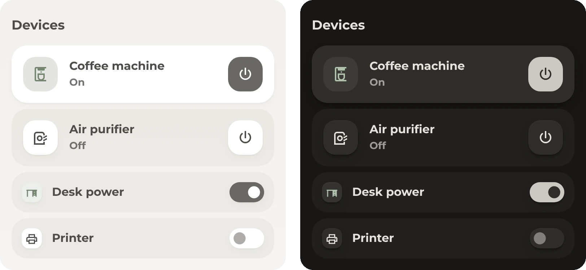

<details>
<summary>Options and example</summary>

<br>

| Option | Default | |
| --- | --- | --- |
| `compact` | `false` | A slim row with a small chip and no state line |
| `toggle` | `false` | The first sub-button becomes a pill switch, ink while on |
| `group` | `false` | Sub-buttons sit in a tray as small keys |
| `tile` | `false` | A flat fill with the chip and controls as raised paper, the quiet counterpart to a card |
| `solid_controls` | `false` | Media cards: the play button is ink while playing, the power button while on |

Per sub-button, `css_class: plain` keeps it neutral and `css_class: accent` makes it ink while the entity is on, even if it navigates. Dropdowns, sliders, readouts and buttons that navigate or open more info stay neutral.

```yaml
# Regular card
type: custom:bubble-card
card_type: button
button_type: switch
entity: switch.coffee_machine
name: Coffee machine
icon: mdi:coffee-maker-outline
modules:
  - origami_base
sub_button:
  main:
    - icon: mdi:power
      show_background: true
      tap_action:
        action: toggle
rows: 1.375
```

```yaml
# Compact row with the pill switch
type: custom:bubble-card
card_type: button
button_type: switch
entity: switch.desk_power
name: Desk power
icon: mdi:desk
modules:
  - origami_base
origami_base:
  compact: true
  toggle: true
  tile: true
sub_button:
  main:
    - icon: mdi:circle
      show_background: true
      tap_action:
        action: toggle
rows: 1
```

On other card types than button and media player, Base only styles the sub-buttons.

</details>

### Light

For lights, on top of Base. The state line shows the brightness, and sliders fill in the light's colour. In dark mode the fill stays neutral and the colour moves into the slider's mark, since a warm colour dark enough for light text turns brown.

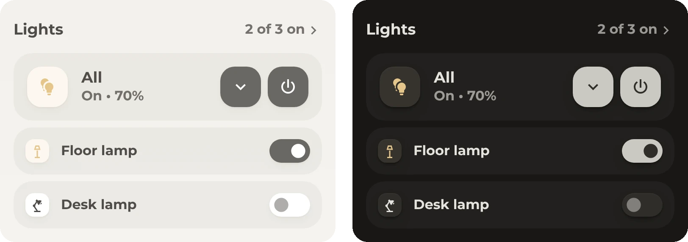

<details>
<summary>Example</summary>

<br>

```yaml
type: custom:bubble-card
card_type: button
button_type: switch
entity: light.living_room
name: All
icon: mdi:lightbulb-multiple
modules:
  - origami_base
  - origami_light
origami_base:
  solid_controls: true
  tile: true
button_action:
  tap_action:
    action: more-info
sub_button:
  main:
    - icon: mdi:chevron-down
      show_background: true
    - icon: mdi:power
      show_background: true
      tap_action:
        action: toggle
state_content:
  - state
  - brightness
rows: 1.375
```

A lamp as a compact row is the Base example above with `origami_light` added.

</details>

### Fan

For fans, on top of Base with `group`. The icon spins at the fan's speed. The power key and the key of the current speed turn ink while the fan runs.

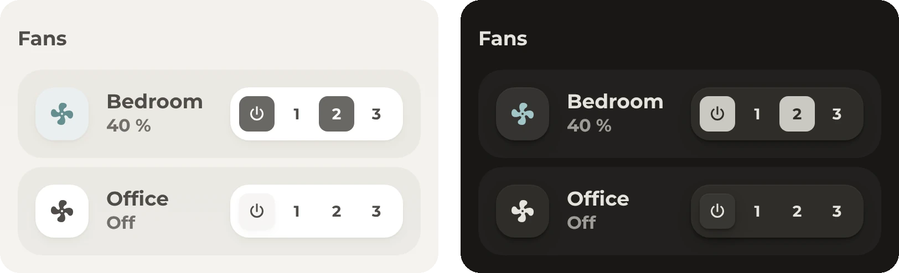

<details>
<summary>Example</summary>

<br>

Sub-button 1 is power, the next three are the speeds. Up to a third counts as speed 1, up to two thirds as speed 2.

```yaml
type: custom:bubble-card
card_type: button
button_type: switch
entity: fan.bedroom
name: Bedroom
icon: mdi:fan
modules:
  - origami_base
  - origami_fan
origami_base:
  group: true
  tile: true
sub_button:
  main:
    - icon: mdi:power
      show_background: true
      tap_action:
        action: perform-action
        perform_action: fan.toggle
        target:
          entity_id: fan.bedroom
    - name: '1'
      show_icon: false
      show_name: true
      show_background: false
      tap_action:
        action: perform-action
        perform_action: fan.set_percentage
        target:
          entity_id: fan.bedroom
        data:
          percentage: 33
    # '2' and '3' the same, with 66 and 100
rows: 1.375
```

</details>

### Climate

For thermostats, on top of Base. Active means the thermostat is doing something, not that a mode is set: the state line says Heating while it heats, Auto while it idles and Off when it is off. The icon follows what it does, and so does the colour.

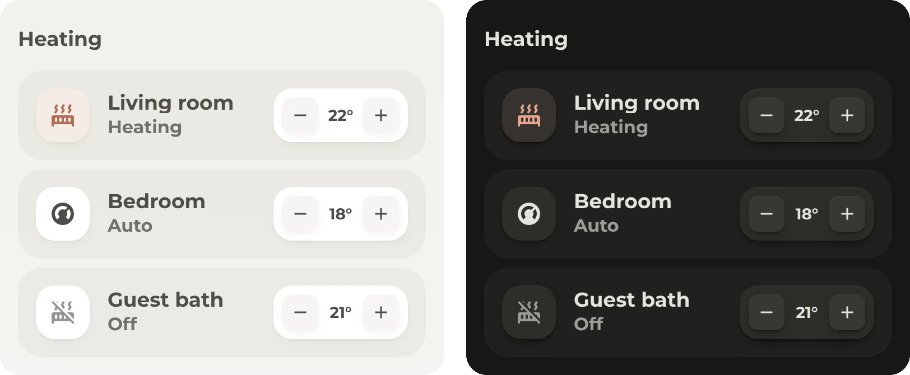

<details>
<summary>Example</summary>

<br>

Give the target temperature a sub-button with `css_class: readout`, the module writes the rounded value into it. `state_content: []` leaves the state line to the module.

```yaml
type: custom:bubble-card
card_type: button
button_type: switch
entity: climate.living_room
name: Living room
icon: mdi:thermostat
state_content: []
modules:
  - origami_base
  - origami_climate
origami_base:
  group: true
  tile: true
sub_button:
  main:
    - icon: mdi:minus
      show_background: true
    - entity: climate.living_room
      css_class: readout
      show_icon: false
      show_name: false
      show_background: false
      state_content: temperature
    - icon: mdi:plus
      show_background: true
rows: 1.375
```

The plus and minus buttons need your own actions, for example a script that moves the target by half a degree.

</details>

### Media

For media players, on top of Base. Speakers show the title and artist while playing and their name otherwise. With an artwork or app entity set, the card is in TV mode and shows the app or what is being cast.

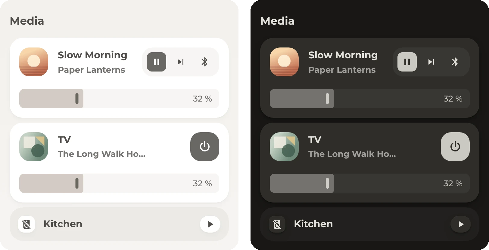

<details>
<summary>Options and example</summary>

<br>

| Option | |
| --- | --- |
| `compact` | A slim row |
| `collapse` | Hides the bottom strip while the player is off |
| `art_entity` | A media player that adds title, app and picture while it plays, like a Chromecast. Turns on TV mode. |
| `app_entity` | A media player that knows the running app, like Android TV Remote. Also the fallback when the card's entity is unavailable. |

```yaml
type: custom:bubble-card
card_type: media-player
button_type: state
entity: media_player.living_room
name: Living room
icon: mdi:speaker
modules:
  - origami_base
  - origami_media
origami_base:
  group: true
hide:
  power_button: true
  previous_button: true
  next_button: true
  volume_button: true
  play_pause_button: true
sub_button:
  main:
    - icon: mdi:pause
      show_background: true
      tap_action:
        action: perform-action
        perform_action: media_player.media_play_pause
        target:
          entity_id: media_player.living_room
    - icon: mdi:skip-next
      show_background: false
      tap_action:
        action: perform-action
        perform_action: media_player.media_next_track
        target:
          entity_id: media_player.living_room
  bottom:
    - entity: media_player.living_room
      sub_button_type: slider
      always_visible: true
rows: '2.2'
state_content: state
```

```yaml
# TV mode
origami_media:
  art_entity: media_player.tv_cast
  app_entity: media_player.tv_cast
```

The module was written for LinkPlay speakers. In speaker mode the cover comes from LinkPlay's `sensor.linkplay_<name>` and group members follow `sensor.linkplay_master`. Other speakers show their icon in the chip. A few speaker names are shortened in the code (`names`), replace them with yours.

</details>

### Speaker Select

Rows for picking a speaker in a music pop-up, on top of Base. The name stays, the line next to it shows what plays. Album art fills the chip and washes the row. A crown marks the group master, a link its members, and the picked speaker gets a stronger row.

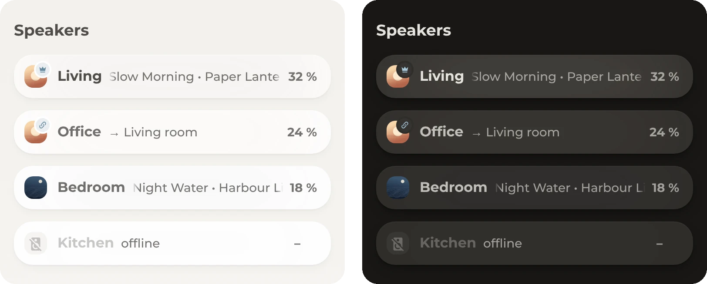

<details>
<summary>Example</summary>

<br>

```yaml
type: custom:bubble-card
card_type: media-player
entity: media_player.living_room
name: Living
force_icon: true
state_content: []
modules:
  - origami_base
  - origami_speaker
hide:
  play_pause_button: true
  volume_button: true
  previous_button: true
  next_button: true
  power_button: true
sub_button:
  main:
    - entity: media_player.living_room
      name: Volume
      css_class: readout
      show_name: true
      show_icon: false
      show_background: false
rows: 1
```

The sub-button with `css_class: readout` gets the volume in percent. Set `origami_speaker: ignore_art` to a comma separated list of URL parts to skip covers that are wrong.

This one is the most personal module. Grouping reads LinkPlay's sensors (`sensor.linkplay_<name>` and `sensor.linkplay_master`), and the picked speaker comes from `input_select.lautsprecher_wahlen`. Change both in the code for your setup.

</details>

### Slider

A slider on its own: the card becomes the track. Base and Slider, in that order.

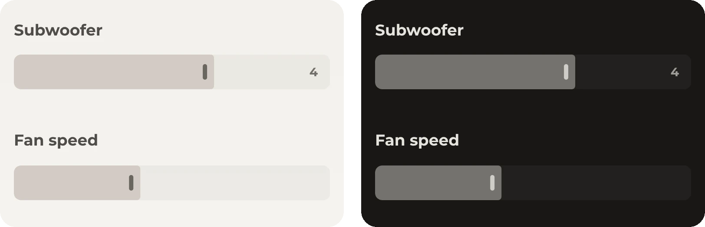

<details>
<summary>Example</summary>

<br>

```yaml
type: custom:bubble-card
card_type: button
button_type: slider
entity: number.subwoofer_level
show_name: false
show_state: false
show_icon: false
slider_value_position: right
tap_action:
  action: none
modules:
  - origami_base
  - origami_slider
rows: 1
```

Use `slider_value_position: hidden` to drop the number.

</details>

### Button

Rows and grids of buttons on a sub-buttons card. Every button goes into `sub_button: bottom` with `show_name: true`.

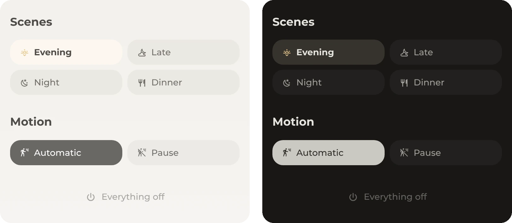

<details>
<summary>Options and example</summary>

<br>

| Option | Default | |
| --- | --- | --- |
| `background` | `true` | Filled buttons, or plain text without |
| `columns` | `0` | `0` sizes buttons to their text, `1` to `6` makes an even grid |
| `align` | `start` | `start`, `center` or `end` |
| `active` | | A template or text. The button whose name or `css_class` matches it lights up, several are separated by commas. A button with an entity that is on lights up too. |
| `active_style` | `lamp` | `lamp` for an amber tint, `toggle` for ink |
| `muted` | `false` | Quieter text |
| `icon_size` | `var(--icon-size-2xs)` | |
| `padding` | `0` | Space around the buttons |
| `animate` | `false` | Fades in from below |
| `press` | `true` | Shrinks a little on press |

```yaml
type: custom:bubble-card
card_type: sub-buttons
modules:
  - origami_button
origami_button:
  columns: 2
  active: "{{ states('sensor.living_room_scene') }}"
sub_button:
  main: []
  bottom:
    - name: Evening
      icon: mdi:weather-sunset-down
      show_name: true
      tap_action:
        action: perform-action
        perform_action: scene.turn_on
        target:
          entity_id: scene.living_room_evening
    - name: Late
      icon: mdi:weather-night-partly-cloudy
      show_name: true
      tap_action:
        action: perform-action
        perform_action: scene.turn_on
        target:
          entity_id: scene.living_room_late
    # Night and Dinner the same
```

`sensor.living_room_scene` holds the name of the active scene, like `evening`. Names are compared in lower case with dashes for spaces, so `Late` matches `late`.

</details>

### Header

A section header: the separator's name is the title, its sub-buttons are the values on the right. Set `grid_options: rows: auto`.

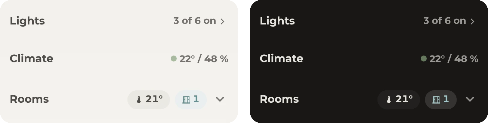

<details>
<summary>Options and example</summary>

<br>

| Option | Default | |
| --- | --- | --- |
| `value_style` | `text` | `text`, or `chip` for pills. A sub-button with `show_background: false` stays plain. |
| `weight` | `bold` | `bold`, `medium` or `regular` |
| `icon_color` | | A colour or a template |
| `icon_size` | `var(--dot-size, 12px)` | For plain values, chips use the small icon size |
| `value_max_width` | | Like `50%`. Long values end with an ellipsis, give that sub-button `scrolling_effect: false`. |

Each sub-button can have its own `origami_header` with `name`, `icon`, `color` and `background`. `color` colours the value, `background` replaces the chip's background, and `var(--tint)` tints it in the value's colour.

```yaml
type: custom:bubble-card
card_type: separator
name: Rooms
modules:
  - origami_header
origami_header:
  value_style: chip
  icon_size: var(--icon-size-l)
grid_options:
  rows: auto
sub_button:
  main:
    - name: Temperature
      entity: sensor.climate_home
      icon: mdi:thermometer
      origami_header:
        name: ${attr.temperature_average}°
    - name: Windows
      entity: sensor.climate_home
      icon: mdi:window-closed-variant
      state_content: windows_open
      origami_header:
        icon: "${attr.windows_open > 0 ? 'mdi:window-open-variant' : ''}"
        color: "${attr.windows_open > 0 ? 'var(--state-binary_sensor-window-on-color)' : 'var(--secondary-text-color)'}"
        background: "${attr.windows_open > 0 ? 'var(--tint)' : ''}"
    - name: Table
      entity: input_boolean.room_climate_card
      icon: mdi:chevron-down
      show_background: false
      origami_header:
        icon:
          'on': mdi:chevron-up
      tap_action:
        action: toggle
```

The header leaves 24 px above itself and 8 px below, which with the 8 px gap of a section makes 32 and 16. In pop-ups, set the same gap with `--bubble-pop-up-gap`. Bubble Card gives the title no tap action, only the sub-buttons take one.

</details>

### Tiles

A grid of quiet tiles on a sub-buttons card: icon chip, name and a state line. Each tile is a sub-button, so Bubble's visibility conditions decide when it exists.

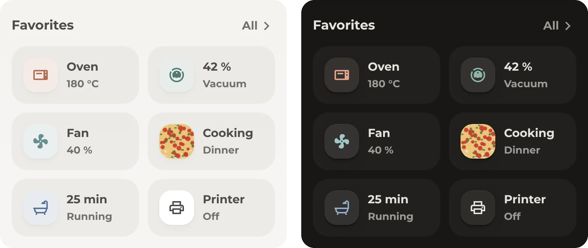

<details>
<summary>Options and example</summary>

<br>

`columns` sets the number of columns, `2` by default. Everything else is set per tile under `origami_tiles`:

| Key | Default | |
| --- | --- | --- |
| `name` | the sub-button's name | |
| `state` | Home Assistant's state | |
| `color` | the state colour while on | Colour of the chip |
| `order` | | Sorts the tile, like `-1` to move it to the front |
| `image` | | A picture instead of the icon |
| `name_color` | | |

```yaml
type: custom:bubble-card
card_type: sub-buttons
modules:
  - origami_tiles
grid_options:
  columns: full
  rows: auto
sub_button:
  bottom:
    - name: Vacuum
      entity: vacuum.robot
      icon: mdi:robot-vacuum
      force_icon: true
      origami_tiles:
        # While it cleans, the progress becomes the name
        name: >-
          ${(p => Number.isNaN(p) || p < 0 ? 'Error'
          : ['docked', 'returning'].includes(state) || p >= 99 ? 'Vacuum'
          : p + ' %')(Math.round(states('number.robot_cleaning_progress')))}
        state:
          docked: 'Off'
          cleaning: Vacuum
        order:
          cleaning: -1
    - name: Cooking
      entity: sensor.dinner
      icon: mdi:chef-hat
      origami_tiles:
        state: Dinner
        image: ${attr.recipe?.image}
      visibility:
        - condition: time
          after: '14:00'
          before: '20:59:59'
```

The [favorites](../README.md#favorites) show more.

</details>

### Popup

The pop-up's header, backdrop and close button. Sub-buttons of the pop-up sit under the title, as text or as chips.

<details>
<summary>Options and example</summary>

<br>

`subtitle_style` is `text` or `chip`. The image at the top of this page is a pop-up with it.

```yaml
type: custom:bubble-card
card_type: pop-up
hash: '#living-room'
name: Living room
show_header: true
show_icon: false
button_type: name
modules:
  - default
  - origami_popup
origami_popup:
  subtitle_style: text
sub_button:
  main:
    - entity: sensor.living_room_temperature
      icon: mdi:thermometer
      show_state: true
      show_background: false
    - entity: sensor.living_room_humidity
      icon: mdi:water-percent
      show_state: true
      show_background: false
cards:
  # the cards of the pop-up
```

The theme sets the pop-up's background. The pop-ups of this dashboard get their own documentation later.

</details>
