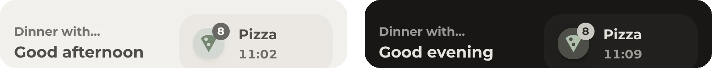
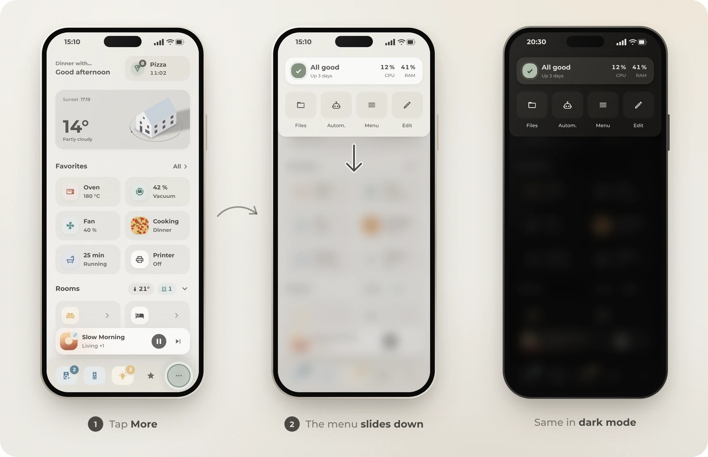
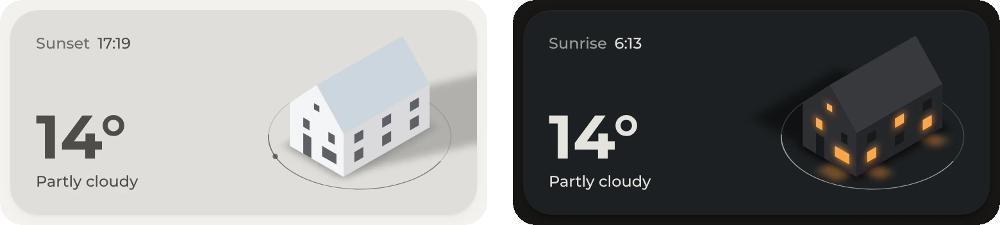
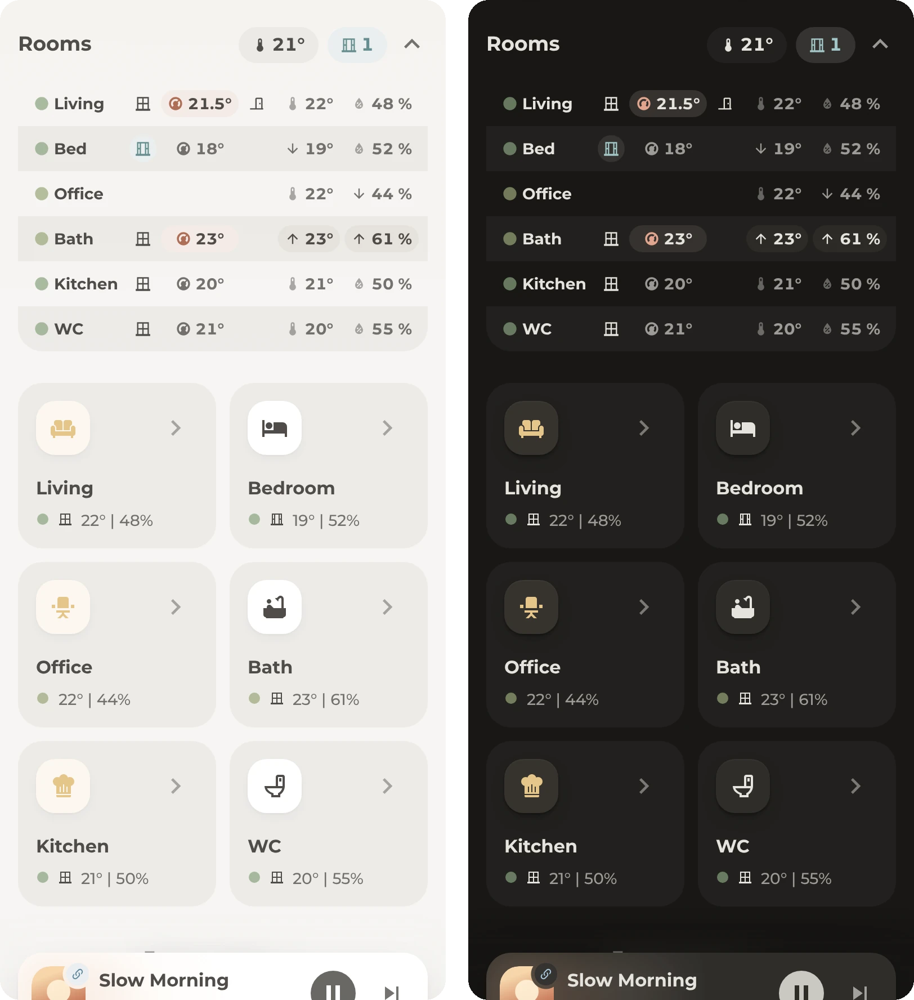
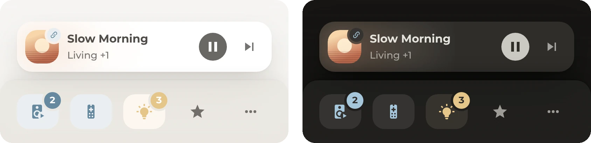
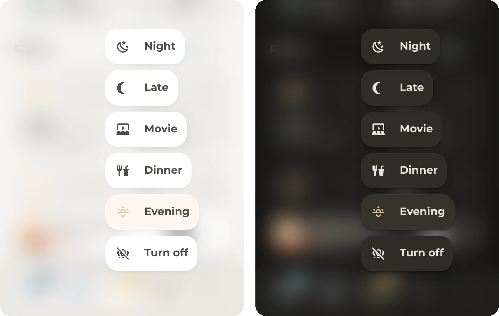

# Dashboard parts

One sections view, made for phones. The desktop layout is still a work in progress. Here's how each part works and which entities it reads. Every part starts with a comment in [`dashboard.yaml`](../dashboard/dashboard.yaml), like `# Favorites`, so you can find and copy it.

Most cards are Paper Buttons Row, folded into cards and layouts, see [Patterns](patterns.md). Cards that show a state get it from a [helper](helpers.md) or a module, so they stay simple. Some ways of building a dashboard add lag on the first load, where you can watch the layout build itself, card-mod or template cards for example. Everything here avoids that, which sometimes leads to unusual solutions. More in [Patterns](patterns.md).

[Greeting and menu](#greeting-and-menu) · [Weather](#weather) · [Favorites](#favorites) · [Rooms](#rooms) · [Navbar](#navbar)

## Greeting and menu

The page starts with the next event, a greeting and the notifications. With the optional [Origami Header](https://github.com/hazymorning/origami_header), Home Assistant's header is gone and becomes a menu that folds out from the top, opened from the navbar.

- The greeting row is a grid card with two columns: a paper-buttons-row with the next calendar entry and the greeting, and [Origami Notifications](https://github.com/hazymorning/origami_notifications). The notifications turn through what needs attention, every 3 seconds. A tap opens the list.
- The menu holds a server card and four buttons: files, automations, the sidebar and edit mode. The card is one paper-buttons-row. Its chip is green when all is good, accent coloured with updates, orange or red when the disk, memory, processor or the last backup need a look. The text says what, and how long the server has been up.
- The navbar's **More** opens the menu with a `fire-dom-event` action.

| Entity | For |
| --- | --- |
| `calendar.household` | The next entry above the greeting |
| `sensor.greetings` | The greeting, see [Helpers](helpers.md) |
| `weather.home` | Rain ahead in the notifications |
| `sensor.system_monitor_*` | Processor, memory, disk and last boot from the [System Monitor](https://www.home-assistant.io/integrations/systemmonitor/) integration |
| `sensor.backup_last_successful_automatic_backup` | From the Backup integration |

The notifications list a few more entities: weather warnings, the calendar, a timer, a countdown, the vacuum and tonight's dinner.

## Weather

An [Origami Weather](https://github.com/hazymorning/origami_weather) card: a calm colour per condition, the house and the temperature.

- Each condition has its own background colour for light and dark mode, set in `background_thresholds`. The sun, moon, clouds, stars, birds, balloons and planes are off, for a calmer card.
- Top left is the next sunset, or the next sunrise while the sun is down. They are two buttons with a visibility condition on `sun.sun`.
- The large number is the weather entity's temperature. For an outdoor sensor of your own, give that text element an `entity` instead of the `attribute`.
- The house is the card's demo house, 20 px from the top, right and bottom edge, like the text. The dashboard this comes from has a drawing of the actual home instead, with a lit window per room while its lights are on. The [Origami Weather readme](https://github.com/hazymorning/origami_weather#layouts) explains how to make one. A picture of your own needs its own offsets.

| Entity | For |
| --- | --- |
| `weather.home` | Condition, background colour and temperature |
| `sun.sun` | Next sunset or sunrise |

## Favorites

Shortcuts that only exist while they matter. A [Header](../bubble_card/README.md#header) row and [Tiles](../bubble_card/README.md#tiles), both Bubble Card.

- Each tile is a sub-button of one Bubble card, and Bubble's visibility conditions decide when it exists. Hidden tiles leave no gap.
- The oven only shows while it's on, and always comes first (`order: -2`). The vacuum moves to the front while it cleans, and its progress becomes the name.
- The fan shows up in warm weather or while it runs. Music shows up late in the evening.
- The dinner tile shows in the afternoon and evening, with the recipe photo as its icon.
- Bath and printer show the minutes left while they run, counted in the browser from an `input_datetime`.
- A tile's colour is Home Assistant's state colour while the entity is on, or set per tile.

The tiles read your own devices. The example uses `sensor.oven`, `vacuum.robot` with `number.robot_cleaning_progress`, `fan.bedroom`, `sensor.dinner` with a `recipe.image` attribute (like [Tandoor](https://tandoor.dev)), `media_player.bedroom`, `input_boolean.bath_time` with `input_datetime.bath_time_end` and `switch.printer` with `input_datetime.printer_end`.

## Rooms

A header with the home's average and the open windows, a climate table that folds out under it, and a card per room.

- The header is a Bubble separator with the [Header](../bubble_card/README.md#header) module in chip style. The window chip turns cyan while a window is open. A tap on a chip or the arrow toggles `input_boolean.room_climate_card`, and the table is a card with a visibility condition on it.
- The table is one paper-buttons-row shaped into a grid of six columns with fixed row heights. Per room: a comfort dot and the name, the window, the thermostat's target, the temperature and the humidity. Keep the names short, so all six columns fit on a phone.
- The thermostat tints while it heats, an open window tints cyan. An arrow marks the warmest, coldest, most humid and driest room.
- Rooms without a thermostat or window contact leave those cells empty, like the office. The front door sits in the spare column of the first row.
- The zebra stripes are one gradient on the row background, sized to the row height.
- Each room card is a paper-buttons-row. The icon chip lights up while the room's lights are on, the dot shows the comfort colour. The whole card opens the room's pop-up, the window icon has its own tap.
- The first four rooms always show. **All rooms** toggles `input_boolean.all_rooms` for the rest.

| Entity | For |
| --- | --- |
| `sensor.climate_<room>` | Per room: `temperature`, `humidity`, `temp_rank`, `humidity_rank`, `color_code` |
| `sensor.climate_home` | `temperature_average` and `windows_open` for the header, `front_door_open` for the status row |
| `binary_sensor.<room>_window` | Window contacts |
| `climate.<room>` | Thermostats, target and `hvac_action` |
| `light.<room>` | The lit chip on the room cards |
| `input_boolean.room_climate_card`, `input_boolean.all_rooms` | The two toggles |

All sensors and both toggles are in the [helpers](helpers.md).

## Navbar

A [Navbar Card](https://github.com/joseluis9595/lovelace-navbar-card) at the bottom: music, TV, lights, favorites and the menu. What plays sits above it.

- Navbar Card's templates are JavaScript, not Jinja. Inside `[[[ ]]]` it's `states['sensor.x'].state`, not `states('sensor.x')`.
- A route is highlighted in its domain's colour while something is on: media light blue, lights amber. A field of tint sits behind the glyph, like the icon chips in the modules.
- The badges count playing speakers and lights that are on. Each badge cuts a small gap into the route's field.
- Holding **Lights** opens the scenes. The active scene is amber.
- Above the bar, Navbar Card's media player shows the speaker that matters right now, picked by `sensor.active_speaker`. A link badge on the cover marks a group, and a hold on **Music** plays or pauses.

| Entity | For |
| --- | --- |
| `sensor.active_speaker_count`, `sensor.lights_on_count` | The badges |
| `sensor.active_speaker` | The now playing card, see [Helpers](helpers.md#active-speaker) |
| `media_player.living_room_tv` | The TV route |
| `media_player.tv_ump` | The TV's now playing card. Any media player works. |
| `light.all_lights`, `script.lights_toggle` | The first button in the scenes switches all lights |
| `scene.living_room_*`, `sensor.living_room_scene` | The scenes and the active one |

